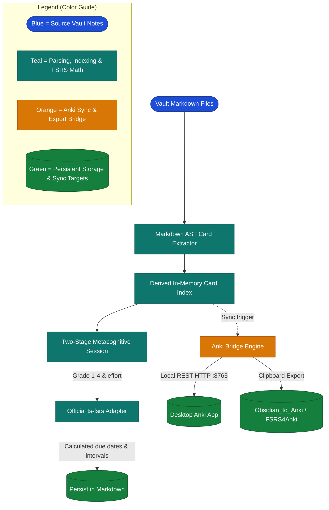

# System Architecture (`ARCHITECTURE.md`)
> **1-Line Summary:** Modular TypeScript spaced repetition and active recall engine embedded in Obsidian with official ts-fsrs scheduling and Anki bridge.

## 1. High-Level Visual System Map

> **Plain-English Explanation:** The system extracts active recall questions from Obsidian vault notes via Markdown AST parsing and caches them in an in-memory index. User reviews update card stability and difficulty using the official `ts-fsrs` algorithm, saving updated parameters back to note comments, while an optional Anki bridge pushes cards directly to desktop Anki via AnkiConnect or exports them to external optimizer tools.

## 2. Tech Stack & Why We Chose It

| Layer | Tool / Library | Plain-English Reason Why |
| :--- | :--- | :--- |
| **Host / UI** | Obsidian Plugin API | Native setting tabs, ribbon icons, and workspace event integration. |
| **Algorithms** | `ts-fsrs` (`^5.0.0`) | Official TypeScript implementation of the Free Spaced Repetition Scheduler. |
| **Card Parser** | Custom AST Parser | Resilient AST line-traversal supporting `::`, `:::`, callouts, and `<!--sr:...-->` tags. |
| **Sync Bridge** | Obsidian `requestUrl` | Direct local HTTP communication with AnkiConnect (`127.0.0.1:8765`). |
| **Bundler** | `esbuild` | Sub-second packaging of modular TypeScript into production `main.js`. |

## 3. Core Subsystems & Engineering Tricks

### [SUBSYSTEM: FSRS-Spaced-Repetition-Adapter] | Aliases: ts-fsrs adapter, stability calculator
> **1-Line Summary:** Bridges card review ratings to the official `ts-fsrs` scheduling algorithm to compute stability, difficulty, and due dates.
* **Code Anchors (Grep Targets):**
  * `src/core/fsrs-adapter.ts` -> `scheduleWithTsFsrs`, `isLeechCard`

### [SUBSYSTEM: Markdown-AST-Card-Extractor] | Aliases: card extractor, ast parser, note syntax
> **1-Line Summary:** Parses flashcard questions, answers, and metadata tags from markdown lines without regex fragility.
* **Code Anchors (Grep Targets):**
  * `src/core/markdown-ast.ts` -> `extractCardsFromMarkdown`, `parseCardMeta`

### [SUBSYSTEM: Reactive-Derived-Card-Index] | Aliases: card cache, in-memory index, vault indexer
> **1-Line Summary:** Reactive in-memory registry listening to vault file modifications and re-indexing cards with $O(1)$ lookups.
* **Code Anchors (Grep Targets):**
  * `src/core/card-index.ts` -> `DerivedCardIndex`, `reindexFile`

### [SUBSYSTEM: Multi-Backend-Anki-Bridge] | Aliases: anki sync, ankiconnect, obsidian to anki
> **1-Line Summary:** Manages bi-directional card pushes to desktop Anki and generates FSRS4Anki review logs.
* **Code Anchors (Grep Targets):**
  * `src/sync/anki-bridge.ts` -> `pushCardToAnkiConnect`, `formatObsidianToAnkiBlock`, `exportFsrs4AnkiReviewLog`

## 4. Extension Recipes: How to Add New Things Safely

* **To add a new flashcard syntax delimiter:**
  1. Open `src/core/markdown-ast.ts` -> `extractCardsFromMarkdown`.
  2. Add the delimiter check inside the block extraction loop.
  3. Ensure both single-line and multi-line boundary conditions retain line offset tracking.
* **To add a new Anki synchronization target:**
  1. Open `src/types.ts` -> `AnkiSyncMode` and add the new mode literal.
  2. Add the handler function in `src/sync/anki-bridge.ts`.
  3. Wire the dropdown option and notification in `src/main.ts` -> `runAnkiSync`.
