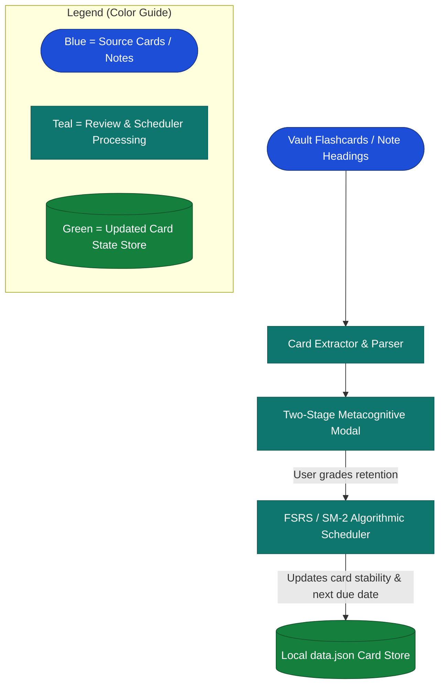

# System Architecture (`ARCHITECTURE.md`)
> **1-Line Summary:** Modular TypeScript spaced repetition engine embedded in Obsidian.

## 1. High-Level Visual System Map

## 2. Tech Stack & Why We Chose It

| Layer | Tool / Library | Plain-English Reason Why |
| --- | --- | --- |
| Host / UI | Obsidian Plugin API | Native modal and view rendering. |
| Algorithms | Custom TypeScript FSRS/SM-2 | Zero external dependencies for scheduling math. |
| Bundler | esbuild | High-speed single file packaging. |

## 3. Core Subsystems & Engineering Tricks

### [SUBSYSTEM: Metacognitive-Card-Scheduler] | Aliases: fsrs scheduler, retention calculator
> **1-Line Summary:** Computes next review intervals based on difficulty, stability, and retrievability.
* **Code Anchors (Grep Targets):**
  * `src/scheduler.ts` -> `nextInterval`

## 4. Recipes: How to Add New Things Safely
* **To add a new flashcard syntax parser:**
  1. Register pattern regex in `src/main.ts` -> `CARD_SYNTAX_PATTERNS`.
