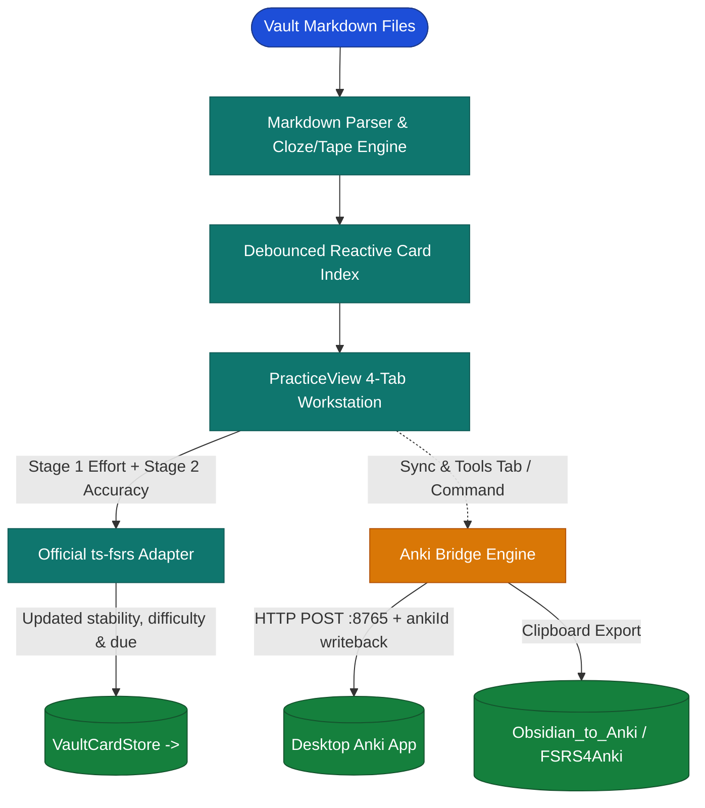

# System Architecture (`ARCHITECTURE.md`)
> **1-Line Summary:** Modular TypeScript spaced repetition and active recall workstation embedded in Obsidian with official `ts-fsrs` scheduling, content-addressed Markdown persistence, and Anki bridge.

## 1. High-Level Visual System Map



## 2. Tech Stack & Why We Chose It

| Layer | Tool / Library | Plain-English Reason Why |
| :--- | :--- | :--- |
| **Host / UI** | Obsidian Plugin API | Native `ItemView`, `Modal`, ribbon icons, `PluginSettingTab`, and `MarkdownRenderer`. |
| **Algorithms** | `ts-fsrs` (`^5.0.0`) | Official TypeScript FSRS implementation with fuzzing and configurable target retention. |
| **Card Parser** | `src/core/markdown-ast.ts` | Line-based parser supporting `> [!question]` callouts, `%%pe-card%%` blocks, header fields (`Type::`, `Difficulty::`, `Subjects::`, `Tags::`, `Concepts::`), and `<!--pe-meta: key=val -->` + `<!--SR:...-->` tags. |
| **Persistence** | `src/core/vault-store.ts` | Atomic `app.vault.process` updates matched by stable card ID (never cached line offsets). |
| **Sync Bridge** | Obsidian `requestUrl` | Local HTTP communication with AnkiConnect (`127.0.0.1:8765`), auto-creating decks and note models. |
| **Bundler** | `esbuild` | Sub-second production bundling into `main.js`. |

## 3. Core Subsystems & Code Anchors

* **`src/core/fsrs-adapter.ts`**: `scheduleWithTsFsrs`, `mapTwoStageToFsrsGrade`, `isLeechCard`, `todayLocalStr`.
* **`src/core/markdown-ast.ts`**: `parseCardsFromMarkdown`, `parseCardHeader`, `parseCardMeta`, `serializeAlignedMeta`, `buildCardMarkdown`, `processClozeAndTapeMarkdown`.
* **`src/core/card-index.ts`**: `DerivedCardIndex`, `rebuildAll`, `scheduleReindex`, `reindexFile`, `onChange`.
* **`src/core/vault-store.ts`**: `VaultCardStore`, `writeCardMetadata`, `updateCardContent`, `addCard`, `deleteCards`, `importSpacedRepetitionCards`.
* **`src/sync/anki-bridge.ts`**: `AnkiBridge`, `checkConnection`, `ensureDeck`, `ensureModel`, `pushCardToAnkiConnect`, `formatObsidianToAnkiBlock`, `exportFsrs4AnkiReviewLog`.
* **`src/ui/practice-view.ts`**: `PracticeView` (`VIEW_TYPE_PRACTICE_ENGINE`).
* **`src/ui/modals.ts`**: `QuestionEditorModal`, `DeleteConfirmModal`.

## 4. Metadata Format Contract

Persisted inline below each card as space-delimited `key=value` pairs inside an HTML comment, optionally followed by an Obsidian Spaced Repetition compatibility tag:

```markdown
<!--pe-meta: id=c_abc12345 due=2026-11-28 ivl=7 reps=2 diff=2.4 s=6.80 d=4.80 lapses=0 attempts=2 ankiId=1732100000 hist=2026-11-21:FC:FL -->
```
