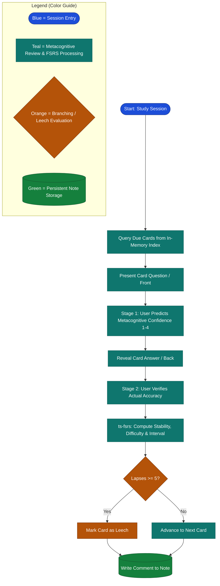
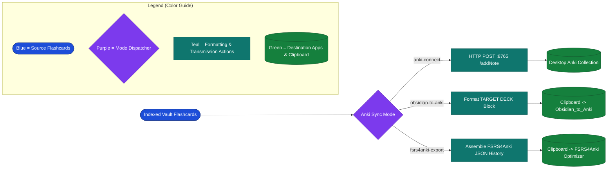

# Visual Feature & Change Log (`VISUAL_LOG.md`)
> **1-Line Summary:** Flowcharts explaining Practice Engine flashcard review lifecycle and multi-mode Anki synchronization.

## Feature & Change Flowcharts

### [VISUAL: Metacognitive-Review-And-FSRS-Lifecycle] | Aliases: review session flow, card grading, fsrs lifecycle
> **1-Line Summary:** End-to-end flow from vault card indexing to metacognitive evaluation and FSRS interval scheduling.

> **Plain-English Explanation:** When a user initiates a study session, due cards are retrieved from memory. Before revealing the answer, the user rates their predicted confidence (Stage 1). After viewing the answer, accuracy is confirmed (Stage 2). The `ts-fsrs` adapter calculates the card's new stability and review date, flags potential leeches, and persists the scheduling metadata into the note.

---

### [VISUAL: Multi-Mode-Anki-Bridge-Pipeline] | Aliases: anki sync pipeline, export workflow
> **1-Line Summary:** Data flow across AnkiConnect local REST calls, clipboard exports, and optimizer logging.

> **Plain-English Explanation:** The user selects their preferred synchronization backend in settings. When triggered, cards are dispatched either directly to desktop Anki via HTTP port 8765, formatted as text blocks for the `Obsidian_to_Anki` plugin, or compiled into standard JSON review logs for parameter optimization in `fsrs4anki`.
