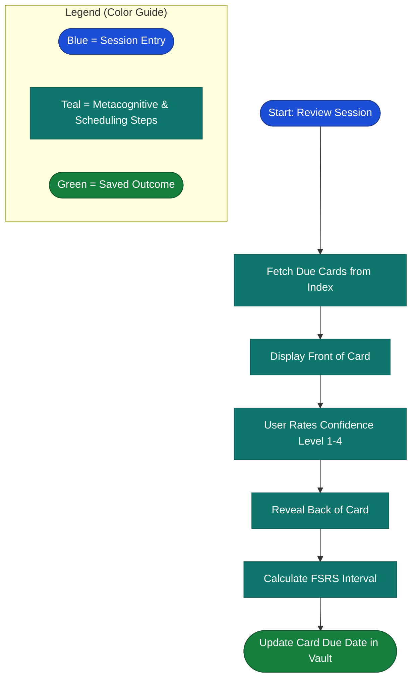

# Visual Feature & Change Log (`VISUAL_LOG.md`)
> **1-Line Summary:** Flowcharts explaining Practice Engine flashcard review lifecycle.

## Feature & Change Flowcharts

### [VISUAL: Active-Recall-Review-Cycle] | Aliases: review session flow, card grading
> **1-Line Summary:** Complete lifecycle of a flashcard from queue extraction to post-review scheduling.

